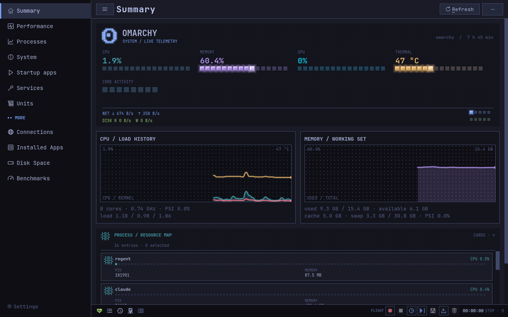
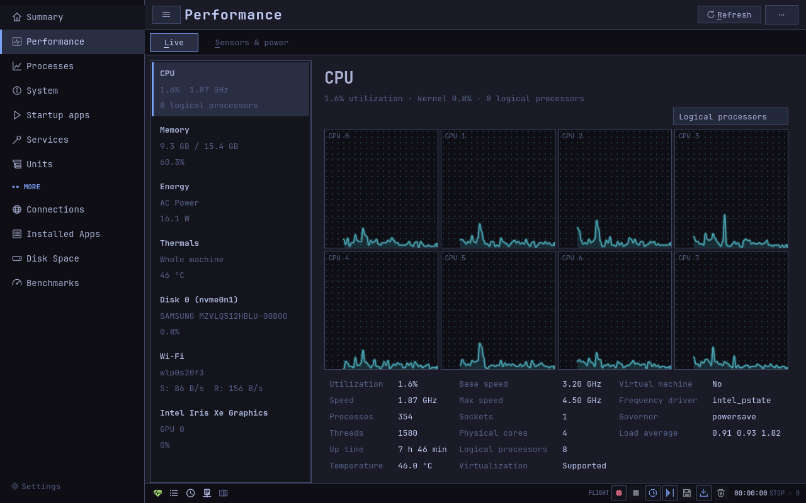
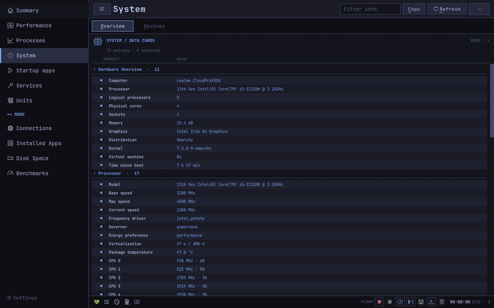

<p align="center"></p>

<h1 align="center">Regent</h1>

<p align="center"><b>A keyboard-first task manager and system monitor for <a href="https://omarchy.org">Omarchy</a> and Hyprland.</b> It knows your windows and workspaces, systemd units and cgroups, notices trouble on its own and records what led up to it. Qt 6 Widgets and C++20, in the colors and font of your Omarchy theme.</p>

<p align="center"><a href="README.ru.md">По-русски</a></p>



- **Ctrl+K command palette**: pages, every command, processes (`kil fir` → Kill firefox) and services (`rst blu`).
- **Hyprland windows**: Workspace and Window columns, focus a process's window (`f`), move it to another workspace, close it. *Pick a window* (Ctrl+Shift+W): switch to any window and Regent shows its process; `regent --active-window` on a key does the same for the focused window.
- **Vim keys in every list**: `j k h l`, `gg G`, `Ctrl+D/U`, `/` to filter, `Esc` back to the list. In Processes `x` ends a task, `X` kills it, `f` focuses its window, `Enter` opens properties.
- **Alerts**: overheating, thermal throttling, memory pressure (PSI), nearly full disks, failed units. The status icon and the bar widget turn red and a notification arrives through `omarchy-notification-send`; clicking it opens the right page.
- **Units**: CPU, memory, disk I/O and task count per slice, service and scope from cgroup v2 accounting ("all of Chrome" as one row); stop, restart, freeze and thaw.
- **GPU load on any GPU**: amdgpu's own counter, NVIDIA through `nvidia-smi`, Intel (i915, xe) and Arm GPUs from the engine time of your processes' DRM clients; a sleeping discrete GPU is left asleep.
- **Deeper process view**: GPU use per process (DRM fdinfo: i915, amdgpu, xe), wakeups per second, I/O priority (ionice), OOM priority, freezing a whole app (cgroup freezer).
- **Services** show the selected unit's journal, errors in red (Ctrl+J).
- **Benchmarks** record the conditions of every score: power profile, AC or battery, temperature before and after, average clock, background load, throttling. The throttle test loads every core for 30–300 s and draws performance, clock and temperature with a verdict ("Throttles: 24% slower by the end, from 18 s…").
- **Power & Freq**: power-profiles-daemon switch and the processes that wake the CPU most.
- **Flight Recorder** marks moments of high load, heat and memory pressure on the timeline and names the likely culprit, compares with a saved session, exports an HTML report (without command lines) and can record on its own, starting two minutes before the trouble.

Dangerous actions are fenced: the compositor, the shell, polkit, portals, the session and Regent itself cannot be suspended or frozen, and stopping or ending them asks for a separate confirmation. Signals go through a pidfd, and nice, affinity, ionice and OOM changes pin every thread first, so a reused PID is never hit.

| Performance | System Info |
|---|---|
|  |  |

## Install

On Arch and Omarchy, the 0.6.0 package from the [release page](https://github.com/Kostya9406/regent/releases/tag/v0.6.0), checked against its SHA256 before it is installed:

```bash
curl -LO https://github.com/Kostya9406/regent/releases/download/v0.6.0/regent-0.6.0-1-x86_64.pkg.tar.zst
echo "089896f1ad0cf752df3d008acf67ca6ff4b58a7d0eb8eb033b344b4757df1547  regent-0.6.0-1-x86_64.pkg.tar.zst" | sha256sum -c && sudo pacman -U ./regent-0.6.0-1-x86_64.pkg.tar.zst
```

Or build the same package from the PKGBUILD of a fixed commit (it pins the source archive's SHA256 too):

```bash
git clone https://github.com/Kostya9406/regent && cd regent
git checkout 08015990516e5ef4f1883866077f2ef80b071ee0 && cd packaging && makepkg -si
```

Or build it by hand. It needs `qt6-base` and a C++20 compiler (no CMake):

```bash
mkdir -p build && cd build
qmake6 .. && make -j"$(nproc)"
./regent
make install        # ~/.local/bin/regent, icon and launcher in ~/.local/share
```

For a system-wide install: `qmake6 PREFIX=/usr .. && make && sudo make install`. Without `PREFIX=/usr`, `sudo make install` would put root-owned files into your `~/.local`.

Optional: `ffmpeg` (video recording of a page), `power-profiles-daemon` (profile switch), `hwdata` (PCI/USB names on the Drivers page). Hyprland and Omarchy are used when present: without Hyprland the window features stay off, and without Omarchy notifications go to any freedesktop notification daemon.

### Bar widget

The Omarchy bar widget lives in its own repository, [omarchy-regent](https://github.com/Kostya9406/omarchy-regent): CPU and memory, temperature, network or the busiest process on the bar, red on alerts.

```bash
omarchy plugin add https://github.com/Kostya9406/omarchy-regent.git --enable
```

### Hyprland bindings

In Omarchy, `~/.config/hypr/bindings.lua`:

```lua
o.bind("SUPER + CTRL + T", "Regent", "regent")
o.bind("SUPER + CTRL + I", "Process of this window", "regent --active-window")
o.bind("SUPER + CTRL + K", "Pick a process", "regent menu")
```

A second launch hands over to the running window, so `regent` on a key summons it from anywhere.

## Pages

| Page | Shows |
|---|---|
| Summary | pixel OMARCHY board, CPU / Memory / GPU / Thermal meters, core map, PSI, network, disks, top processes |
| Performance | **Live**: CPU (total and per-core graphs), memory, energy, temperatures, disks, network, GPU. **Sensors & power**: clocks, hwmon, battery, RAPL, cpufreq policy, power profile, top wakeups |
| Processes | `/proc/<pid>/*`, grouped by app (Hyprland windows, then background), by user or as the parent tree; GPU, wakeups, workspace and window |
| System | **Overview**: DMI, os-release, CPU, memory, graphics, storage, power, network, data sources. **Devices**: PCI/USB devices and their drivers, kernel modules |
| Startup apps | what Hyprland starts (your `~/.config/hypr/autostart.lua`, which Regent can switch line by line, and Omarchy's own) and XDG autostart |
| Services | systemd over D-Bus, system and user bus, Start / Stop / Restart through polkit, journal |
| Units | cgroup v2 tree: resources per slice / service / scope, Stop / Restart / Freeze / Thaw |
| Connections | TCP/UDP/Unix sockets from `/proc/net/*` and their owners, reachability class, traffic panel |
| Installed Apps | the local pacman database and packages' `.desktop` files |
| Disk Space | pixel map of used space, background scanner, treemap, file types and largest files |
| Benchmarks | CPU (one core and all cores), throttle test, memory, disk (cached or direct I/O), OpenGL, download from a URL; conditions of each run, history, CSV |
| Flight Recorder (bottom dock) | snapshot history, marked moments, comparison, HTML report, auto-recording |

Every list has two views, switched with `v` and remembered per page. **Rows**, the default for long lists (Processes, Services, Connections, sensors, packages, devices), show one line per entry with as many columns as fit; click a column header to sort by it. **Cards** show every column in full (long values wrap to six lines, the rest in a tooltip), fields in the same place on every card. Pages with parts switch them with Alt and the underlined letter (Performance: Alt+L, Alt+S; System: Alt+O, Alt+D). Hierarchy is shown by indentation and sections (`▸/▾`, Right/Left or `l/h`), `s` or Ctrl+G sorts, Ctrl+click and Shift+click select several. Page keys (`x`, Delete, Enter, Menu) and the context menu act on the selection in either view.

## Keys

| Keys | Action |
|---|---|
| Ctrl+K (Ctrl+P) | command palette |
| Ctrl+1 … Ctrl+9, Ctrl+Tab / Ctrl+Shift+Tab | pages |
| j k h l, gg G, Ctrl+D / Ctrl+U | move through any list |
| / or Ctrl+F, Esc | page filter, back to the list |
| x / X, Delete / Shift+Delete | end (SIGTERM) / kill (SIGKILL, confirmed) |
| f, Ctrl+Enter | focus the process's window |
| Ctrl+Shift+W | find a window's process: switch to that window |
| Enter, Menu | process properties, context menu |
| Ctrl+J | service journal (Services) |
| Ctrl+Shift+E | Flight Recorder HTML report |
| Ctrl+Shift+F, Ctrl+Shift+H / S / O | Flight Recorder: record, history, save as, open |
| Ctrl+G, s | sort the list |
| v | rows or cards |
| Ctrl+B | sidebar |
| F5, Ctrl+N, Ctrl+Shift+R, Ctrl+Shift+P | refresh, run new task, record the page as video, page in its own window |
| Ctrl+R | Disk Space: scan |
| Ctrl+, , F10, F1 | settings, all commands, about |

## Command line

```
regent                          open the window or raise the running one
regent --page processes         the same, on a given page
regent --select-pid 1234        Processes with that process selected
regent --active-window          Processes on the focused window's process
regent menu                     pick a process in the Omarchy menu (or walker/fuzzel/wofi/rofi), then an action
regent top [-n 15] [--sort cpu|mem|gpu|wakeups]
regent kill NAME|PID… [--force] [--all]
regent --json [--fields cpu,mem,temp]          one snapshot as JSON
regent --stream 2000 [--notify] [--fields …]   a JSON line every 2000 ms (250 at least), with alerts
QT_QPA_PLATFORM=offscreen regent --capture-pages DIR   PNG of every page
```

A second launch passes its command to the first through `$XDG_RUNTIME_DIR/regent-instance-v1` and exits. The JSON schema is in `src/core/Json.h` (`"schema": 1`); keys are only ever added. `--stream` adds `alerts` and `alertLevel`. `--fields` aliases: `mem`, `temp`, `net`, `gpu`, `top`, `procs`, and dotted paths.

## Alerts

Thresholds are set in Settings (Ctrl+,) and shared by the window and the bar: CPU temperature (90 °C for 10 s by default), memory pressure PSI (20 %), free space (5 %), throttling, failed units and, if you want, long CPU load. Units already failed at start are background; an alert comes when a unit fails later (a unit failing in a loop, at most once in 10 minutes). One Regent process per session sends notifications: the one holding `$XDG_RUNTIME_DIR/regent-alerts-UID.lock`, usually the bar's `--stream --notify`.

## Code

```
src/core/      data and actions, no GUI
  Sampler        procfs/sysfs snapshot, Hyprland windows, per-process GPU and wakeups
  SamplingEngine Sampler on its own QThread, publishes a SnapshotPtr to the GUI
  Snapshot.h     the immutable snapshot every page reads
  Hyprland       Hyprland socket: windows, focus, move, close (Lua dispatchers)
  Cgroups        cgroup v2 accounting per unit
  Alerts, Notify thresholds with hold time and hysteresis, notifications
  Actions        signals through pidfd, nice, affinity, ionice, OOM, protection of critical processes and units
  Services       systemd over D-Bus, including Freeze/Thaw and failed units
  FlightRecorder, FlightReport   snapshot history, marked moments, HTML report
  Cli            top / kill / menu / --fields
  Startup, Inventory, HwIds, Connections, DiskScan, Benchmarks, Json, Settings
src/ui/        shell (MainWindow), command palette, Vim keys, theme, drawn widgets, pages
packaging/     regent.desktop, regent.svg, PKGBUILD
tests/         tests, see tests/README.md (tests/run-all.sh runs them all)
```

## License

MIT, see [LICENSE](LICENSE).
